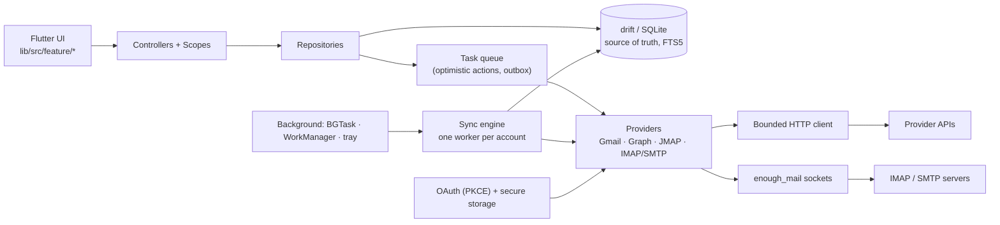

# Project Proposal — Flutter App

## Project Understanding
You need assistance with: 
**Native app: multi-platform Flutter mail client (mailchecker_app) — design and implementation plan**

*Project description:*
A native, multi-platform mail client built with Flutter, in a separate repository **`ziqq/mailchecker_app`** (bootstrapped from [`ziqq/flutter_template`](https://github.com/ziqq/flutter_template)). It is the app counterpart of the extension, in the spirit of **Spark** and **Apple Mail**: a unified Smart Inbox for Gmail / Google Workspace, Outlook / Microsoft 365, JMAP and any IMAP/SMTP mailbox, on iOS, Android, macOS, Windows and Linux.

The extension's principles carry over unchanged: **no backend, no client secrets, credentials and mail stay on the device**, untrusted mail HTML is sanitized and rendered without scripts, every request is bounded.

Design mockups: [`design/app/app-flutter-mockup.html`](../blob/main/design/app/app-flutter-mockup.html) (`?theme=dark`), rendered screens in [`design/app/screens/`](../tree/main/design/app/screens), references in [`design/app/references/`](../tree/main/design/app/references).

## Design

| Phone · Smart Inbox | Phone · swipe + snooze | Phone · reader | Phone · send later | Phone · onboarding |
| --- | --- | --- | --- | --- |
|  |  |  |  |  |

Tablet (sidebar · list · reader):


Desktop (keyboard-first, command palette):


Every screen exists in light and dark (`*-light.webp`, `*-dark.webp`). The mockups use the extension's tokens (`src/styles/_tokens.scss`, `design/mockup.css`): warm accent palette and the neutral palette, Inter, pill controls, Smart Inbox sections, account colour dots, the privacy bar and the white "paper" for HTML mail.

### Design principles

- **People first.** Smart Inbox: Pinned → People → stacked Notifications / Newsletters (`×N`), grouped by day. Category chips filter the list.
- **One unified inbox**, account identity shown by a colour dot on the avatar, per-account views in the sidebar / drawer.
- **Fast triage.** Configurable swipes (short/long, left/right), multi-select, undo snackbar for every destructive action, keyboard shortcuts (`J/K`, `E`, `#`, `U`, `S`, `H`, `R`, `/`, `⌘K`) on desktop and tablets with keyboards.
- **Adaptive, not just responsive**: Cupertino feel on iOS/macOS (large titles, sheets, context menus), Material 3 on Android/Windows/Linux, with a shared token layer.
- **Private by default**: remote content blocked until allowed, trackers counted and shown, nothing leaves the device except requests to the user's mail providers.

### Breakpoints (logical px)

| Width | Layout |
| --- | --- |
| < 600 | One pane: list **or** reader (push), bottom bar (Inbox · Snoozed · Search · Accounts), FAB compose |
| 600–1099 | List · reader, drawer for mailboxes and folders |
| ≥ 1100 | Sidebar · list · reader; draggable dividers (min reader width 320, as in the extension) |
| Desktop windows | Same as ≥ 1100 plus title bar, menu bar / tray item, multiple compose windows (later) |

## Research summary

Sources were read in full or in part (shallow clones): [Maily / enough_mail_app](https://github.com/Enough-Software/enough_mail_app) and [enough_mail](https://github.com/Enough-Software/enough_mail) (Flutter/Dart), [Thunderbird for Android](https://github.com/thunderbird/thunderbird-android) (Kotlin), [Mailspring](https://github.com/Foundry376/Mailspring) (Electron + C++ `mailsync`). Spark and Apple Mail are closed source; their behaviour comes from their sites, help pages and the screenshots in `design/app/references/` (Spark site, Apple Mail guide, Pinterest and Dribbble boards).

| Source | What we take | What we avoid |
| --- | --- | --- |
| **Spark** | Smart Inbox (People / Notifications / Newsletters), Pin, Snooze, Send later, Reminders ("if no reply"), Gatekeeper for first-time senders, swipe presets, templates, signatures per identity, quick reply | Team features, shared drafts, AI and push that need Readdle's servers (we have no backend) |
| **Apple Mail** | Categories, Remind Me, Follow-Up suggestions, Undo Send (delay), Mail Privacy Protection–style remote content blocking, clean reader, large titles and sheets on iOS | iCloud-only features (Hide My Email) |
| **Maily / enough_mail** | `enough_mail`: production IMAP/SMTP/POP client in pure Dart with CONDSTORE/QRESYNC, IDLE, MIME parsing, `Discover` (autoconfig); its OAuth via `flutter_web_auth_2`; `background_fetch` integration | No local database (everything is refetched), mixed Riverpod/GetIt state, `webview_flutter` without strict CSP |
| **Thunderbird Android** | Feature-module split (`feature/account`, `autodiscovery`, `mail`, `notification`, `search`, `widget`), autodiscovery chain: ISPDB → provider `.well-known/autoconfig` → MX lookup → re-query; push via IMAP IDLE foreground service | Legacy K-9 storage layer |
| **Mailspring** | Offline-first: local SQLite is the source of truth, a persisted **task queue** applies changes optimistically, syncs them back and rolls back on failure (`ChangeUnreadTask`, `ChangeFolderTask`, `SendDraftTask`, `SyncbackDraftTask`…); separate sync worker per account | Snooze / send later / tracking that depend on the Mailspring ID backend |

## Scope

### v1 (this issue)

- Accounts: Gmail / Google Workspace (Gmail API, OAuth + PKCE), Outlook / Microsoft 365 / Outlook.com (Microsoft Graph, OAuth + PKCE), JMAP (Fastmail, Stalwart…; token or OAuth), IMAP/SMTP with autodiscovery (iCloud, Yandex, Mail.ru, any domain; app passwords; XOAUTH2 where available). Multiple accounts per provider.
- Unified Smart Inbox, per-account Inbox, folders/labels, common views by role (Sent, Drafts, Archive, Spam, Trash), Pinned (star / flag), Snoozed, Scheduled.
- Conversation reader: threads, collapsed earlier messages, sanitized HTML, blocked remote content and trackers, attachments (preview, save, share), `List-Unsubscribe` one-tap.
- Actions: read/unread, pin, archive, trash, move, label, spam, block sender, multi-select, swipes, undo.
- Compose: new, reply, reply all, forward, identities/aliases, signatures, attachments, drafts synced to the server, undo send, send later, templates (local).
- Search: local full-text over the cache plus server search with operators (`from:`, `to:`, `has:attachment`, `is:unread`, dates).
- Snooze, "remind me if no reply", Gatekeeper (accept / block first-time senders).
- Notifications (new mail from People / VIP only / all, per account), badge, notification actions (archive, mark read, reply where the OS allows).
- Offline: cached lists and bodies, queued actions and outbox.
- Settings: appearance (palette × light/dark/system, density), swipes, notifications, accounts and colours, signatures, privacy, app lock.
- 13 locales of the extension (`en` reference).

### Not in v1

Calendar/contacts sync (ICS invites are shown and answered), AI summaries, team features, read receipts/tracking, PGP/S/MIME, POP3, widgets, watch apps, Safari extension containing app (see #3 — the macOS/iOS targets may host it later), settings sync between devices.

## Constraints that follow from "no backend"

| Feature | Without backend | Decision |
| --- | --- | --- |
| Real-time push | Gmail `watch` needs Pub/Sub, Graph subscriptions need a webhook, APNs/FCM need a sender | Foreground: IMAP IDLE, JMAP push (EventSource), polling Gmail `history.list` / Graph delta. Background: iOS `BGAppRefreshTask` (opportunistic), Android WorkManager (≥ 15 min) + optional IDLE foreground service, desktop runs in the tray / menu bar. The template's `firebase_messaging` is not used for mail. |
| Send later | Needs something to send at the time | Outlook: server-side deferred delivery (`PidTagDeferredSendTime`). JMAP: `FUTURERELEASE` (`EmailSubmission.sendAt`) when advertised. Gmail and IMAP: local scheduled outbox, sent when the app can run; the UI says so (see mockup). |
| Snooze | Timer must fire somewhere | The message leaves the Inbox on the server (Gmail label / `mailchecker/Snoozed` folder), wake time is stored locally and, where possible, in a hidden per-account record (open question); returns to Inbox on the next run after the time. |
| Gatekeeper, templates, VIPs | Lists must live somewhere | Device-local in v1; optional export/import. |

## Architecture

Follows the template: `lib/src/feature/<domain>/{controller,data,model,widget}`, `control` controllers (`AppController$Sequential` with sealed states), `InheritedModel` scopes, `squid` navigation, `drift`, `IFooRepository` + `FooRepository` + `FooRepository$Fake`, `package:l` logging, no `dynamic` in JSON parsing.



### Workspace packages

| Package | Contents | Depends on |
| --- | --- | --- |
| `packages/mail` (pure Dart) | Domain models, `MailProvider` contract, Smart Inbox (`categorize`, merge, stacks, sections — ported from `providers/message.ts` and `shared/inbox.ts` with the same test cases), HTML sanitizer, address/MIME helpers, provider adapters, sync engine, task queue, drift database | `enough_mail`, `drift`, `http` |
| `packages/ui` (template) | Tokens as `ThemeExtension` (two palettes × light/dark, mirrored from `_tokens.scss`), Inter, avatars, chips, rows, sheets, adaptive scaffolds | Flutter |
| app `lib/` | Features: `onboarding`, `accounts`, `inbox`, `thread`, `compose`, `search`, `snooze`, `notifications`, `settings`, `developer` (template) | both packages |

Keeping protocol code in a pure Dart package makes it testable with `dart test` against fakes and local servers, and keeps Flutter plugins at the edges.

### Provider contract

```dart
abstract interface class MailProvider {
  ProviderCapabilities get capabilities; // labels vs folders, threads, send later, push, search operators
  Future<List<Folder>> folders();
  Future<SyncPage> initialSync(FolderRef folder, {required int limit});
  Future<SyncDelta> changes(SyncCursor cursor); // historyId · deltaLink · JMAP state · MODSEQ
  Future<Thread> thread(ThreadRef ref);
  Future<Uint8List> attachment(AttachmentRef ref);
  Future<void> apply(MailTask task); // read, flag, move, label, trash, spam
  Future<SentMessage> send(OutgoingMessage message, {DateTime? at});
  Future<DraftRef> saveDraft(OutgoingMessage message, {DraftRef? replace});
  Future<SearchPage> search(MailQuery query, {SearchCursor? cursor});
  Stream<void> watch(); // IDLE / JMAP push / polling, foreground only
}
```

| Provider | Incremental sync | Notes |
| --- | --- | --- |
| Gmail API | `users.history.list` from `historyId`; full resync on 404 | Labels ≠ folders; categories from `CATEGORY_*`; scopes `gmail.modify` (+ `gmail.compose` for drafts) |
| Microsoft Graph | `/messages/delta` per folder with `deltaLink` | `inferenceClassification` (Focused), `conversationId`, deferred send |
| JMAP | `Email/changes`, `Mailbox/changes`, `Thread/changes` from `state` | Push via `EventSource`; `FUTURERELEASE`; blob upload for attachments |
| IMAP/SMTP | `CONDSTORE`/`QRESYNC` (`HIGHESTMODSEQ`, `VANISHED`), fallback to UID + flags diff; `UIDVALIDITY` reset | `enough_mail`; threads by `References`/`In-Reply-To` (+ `X-GM-THRID` on Gmail IMAP); `SPECIAL-USE` roles; autodiscovery like Thunderbird; `APPEND` to Sent when the server does not |

### Local database (drift)

`accounts` (public part only) · `identities` · `folders` (role, counts, sync cursor) · `messages` (headers, flags, category, snippet, sizes) · `message_folders` / `message_labels` · `threads` · `bodies` (sanitized HTML + text, bounded, evictable) · `attachments` (metadata; files in app cache) · `tasks` (queued actions with retry/backoff and rollback data) · `outbox` (drafts, scheduled sends, undo window) · `snoozes` · `rules` (Gatekeeper, VIP, blocked) · `contacts` (seen addresses for autocomplete) · `messages_fts` (FTS5 over subject, from/to, snippet, text body).

- The DB is the single source of truth for the UI (drift `watch` streams); sync and the task queue write to it.
- Budget: N recent messages per folder (default 500/Inbox, 200/other), bodies LRU-capped (default 200 MB), attachments on demand.
- Optional encryption (SQLCipher) behind the app-lock setting — spike.

### Task queue (from Mailspring)

Each action becomes a persisted `MailTask`: apply locally → show undo → after the undo window, send to the provider with bounded retries → on a permanent error, roll back and report. Tasks on the same message are ordered; the sync engine does not overwrite fields with pending local changes. The outbox uses the same queue (`SendTask`, `SaveDraftTask`).

### Security and privacy

- Tokens and passwords only in `flutter_secure_storage` (Keychain / Android Keystore / Windows Credential Manager / libsecret). The DB holds no secrets.
- One bounded HTTP client (port of `http.ts`): HTTPS only, no redirects, no cookies, timeouts, response-size limits, concurrency limit, `AuthError` → single-flight token refresh. IMAP/SMTP: TLS required by default, STARTTLS allowed, plaintext only with an explicit warning.
- Mail HTML: sanitize in Dart (port of `shared/sanitize.ts` rules) → render in a web view with **JavaScript disabled**, a strict CSP (`default-src 'none'; img-src data:; style-src 'unsafe-inline'`, remote images only after consent), navigation intercepted and opened externally. Linux and fallback: `flutter_widget_from_html_core` (spike decides).
- OAuth: public clients with PKCE; mobile — system browser via `ASWebAuthenticationSession` / Custom Tabs (`flutter_appauth`); desktop — loopback redirect `http://127.0.0.1:<port>`. New Google clients (iOS, Android, Desktop) and a Microsoft public client with mobile/desktop redirect URIs; the extension's client IDs do not apply.
- Gmail scopes are restricted: public release needs Google's restricted-scope verification (see `docs/OAUTH.md`); IMAP for Gmail via XOAUTH2 would need `https://mail.google.com/`, so Gmail goes through the API only.
- App lock (`local_auth`), hiding content in the app switcher, no analytics on mail content; Sentry with scrubbing (template) — opt-in.

## Implementation plan

Branches and commits follow the template (`author/github-<n>/<desc>`, Conventional Commits). Each milestone ends with `make precommit` green and a demo build.

### M0 · Bootstrap and spikes
- [ ] Create `ziqq/mailchecker_app` from the template; rename identifiers, bundle IDs (`dev`/`prod` flavors), app name, icons; license header (GPL-3.0-only) as in this repo.
- [ ] Remove template features not needed (`money2`, `sensors_plus`, Firebase messaging if unused) after confirming with the maintainer.
- [ ] CI: analyze, tests, builds for Android, iOS (no signing), macOS, Windows, Linux.
- [ ] Spike: HTML rendering with JS off + CSP on all five platforms; pick the web view package.
- [ ] Spike: OAuth PKCE for Google and Microsoft on all five platforms (mobile redirect, desktop loopback).
- [ ] Spike: `enough_mail` against iCloud, Yandex, Mail.ru and a local Dovecot/GreenMail; QRESYNC and IDLE.
- [ ] Spike: background fetch on iOS and Android; tray/menu-bar on desktop (`window_manager` + tray).
- [ ] Spike: rich-text compose editor (plain text + basic formatting → HTML).
- [ ] ADR document in `docs/` with the decisions.

### M1 · Domain, storage, sandbox
- [ ] `packages/mail`: models, `MailProvider`, capabilities, errors.
- [ ] Port Smart Inbox logic and the sanitizer with the extension's regression cases.
- [ ] drift schema, migrations test, FTS5, cache budgets and eviction.
- [ ] Secure credential store; bounded HTTP client.
- [ ] `FakeMailProvider` + fixtures and a **sandbox flavor** (like `npm run sandbox`): the whole UI on mock mailboxes, no network.

### M2 · Providers: read path
- [ ] Gmail: profile, labels, list, threads, bodies, attachments, `history` sync.
- [ ] Graph: folders, delta sync, conversations, attachments.
- [ ] JMAP: session, mailboxes, changes, threads, push.
- [ ] IMAP: autodiscovery (ISPDB → well-known → MX), login, special-use roles, QRESYNC/CONDSTORE sync, IDLE, threading.
- [ ] Sync engine: per-account worker, backoff, connectivity awareness, cursors in DB.

### M3 · Core UI
- [ ] Tokens → `ThemeExtension` in `packages/ui`; palettes × light/dark/system; Inter.
- [ ] Adaptive shell (three breakpoints), sidebar/drawer, bottom bar.
- [ ] Onboarding and add-account flows (OAuth, IMAP manual/auto, JMAP).
- [ ] Inbox list: sections, stacks, chips, account dots, infinite scroll, pull to refresh.
- [ ] Reader: thread, collapsed history, privacy bar, attachments, quick reply.
- [ ] Folders and common role views; localization (13 locales).
- [ ] Golden tests at phone / tablet / desktop widths, light and dark.

### M4 · Actions and offline
- [ ] Task queue with persistence, ordering, retries, rollback.
- [ ] Read, pin, archive, trash, move, label, spam, block sender; multi-select; undo.
- [ ] Configurable swipes; keyboard shortcuts and command palette.

### M5 · Compose
- [ ] Composer: new / reply / reply all / forward, identities, recipients autocomplete, attachments (picker, share sheet, drag & drop on desktop).
- [ ] Draft sync per provider; signatures; local templates.
- [ ] Undo send (configurable delay), send later (server-side where supported, local outbox otherwise).

### M6 · Search
- [ ] Local FTS with operators, highlighted results.
- [ ] Server search per provider merged with local results, paging per account.

### M7 · Notifications and background
- [ ] Local notifications with filters (People / VIP / all, per account), quiet hours, badge.
- [ ] Notification actions; deep links into the thread.
- [ ] iOS `BGAppRefreshTask`, Android WorkManager + optional IDLE foreground service, desktop tray with unread count and start at login.

### M8 · Productivity
- [ ] Snooze (presets as in the mockup, custom date), Snoozed view, wake-up handling.
- [ ] "Remind me if no reply" for sent mail.
- [ ] Gatekeeper for first-time senders; `List-Unsubscribe` (mailto / one-click POST).

### M9 · Hardening and release
- [ ] App lock, optional DB encryption, privacy screen.
- [ ] Accessibility (screen readers, Dynamic Type / text scale, contrast, focus order).
- [ ] Performance budget: cold start, 10k-message folders, scroll at 60/120 fps.
- [ ] Google restricted-scope verification, Microsoft publisher verification, privacy policy (extend `PRIVACY.md`).
- [ ] Store listings and packaging: App Store / TestFlight, Google Play, Mac App Store or notarized DMG, MSIX, Flatpak/AppImage.

## Testing

- `packages/mail`: unit tests with recorded provider fixtures (JSON / IMAP transcripts), sync engine tests with fake providers, property tests for threading and Smart Inbox.
- Integration tests in CI against Dockerized **GreenMail/Dovecot** (IMAP/SMTP) and **Stalwart** (JMAP).
- App: widget and golden tests per breakpoint and theme; `integration_test` flows on the sandbox flavor (add account → triage → compose → search), mirroring `e2e/sandbox.spec.mjs`.
- Manual matrix per milestone: iPhone, Android phone, iPad, macOS, Windows, Linux; real Gmail, Outlook, Fastmail, iCloud, Yandex accounts (test accounts only).

## Open questions

1. App name and bundle IDs (`mailchecker` / `com.ziqq.mailchecker`?), and is the app free / open source under GPL-3.0 like the extension?
2. Is **web** a target? (No raw IMAP sockets in browsers; the extension already covers the browser.) Proposal: no.
3. Should the macOS/iOS app also become the Safari extension's containing app (#3), sharing OAuth and Keychain?
4. Gmail through the API only (restricted-scope verification) — or also IMAP + app password as a fallback until verification?
5. Snooze/send-later state across devices: accept device-local in v1, or encode it on the server (hidden label/folder, JMAP keywords)?
6. Keep Firebase (analytics, messaging) and Sentry from the template, or drop them for privacy?
7. Minimum OS versions (proposal: iOS 16, Android 8 / API 26, macOS 13, Windows 10, Ubuntu 22.04).
8. Does the extension and the app share code (e.g. sanitizer and Smart Inbox fixtures as JSON test vectors kept in one place)?

## References

- Extension: [Architecture](../blob/main/docs/ARCHITECTURE.md), [OAuth](../blob/main/docs/OAUTH.md), [Privacy](../blob/main/PRIVACY.md), [Safari app #3](https://github.com/ziqq/mailchecker/issues/3).
- Protocols: [Gmail API sync](https://developers.google.com/workspace/gmail/api/guides/sync), [Graph delta query](https://learn.microsoft.com/graph/delta-query-messages), [JMAP Mail RFC 8621](https://www.rfc-editor.org/rfc/rfc8621), [IMAP QRESYNC RFC 7162](https://www.rfc-editor.org/rfc/rfc7162), [Autoconfig](https://wiki.mozilla.org/Thunderbird:Autoconfiguration), [One-click unsubscribe RFC 8058](https://www.rfc-editor.org/rfc/rfc8058).
- Code: [enough_mail](https://github.com/Enough-Software/enough_mail), [enough_mail_app](https://github.com/Enough-Software/enough_mail_app), [thunderbird-android](https://github.com/thunderbird/thunderbird-android), [Mailspring](https://github.com/Foundry376/Mailspring).
- Design: [Spark](https://sparkmailapp.com/features), [Apple Mail guide](https://support.apple.com/guide/mail/welcome/mac), Pinterest boards "email app ui", "mail client desktop ui", "email app dark mode ui" (captures in `design/app/references/`).


## Scope of Work
- Asset analysis and workspace initialization.
- Core modeling / development based on specifications.
- Technical validation and quality checks.
- Incorporation of review feedback.
- Clean handover of source files and documentation.

## Required Files & Inputs
1. Complete reference files (drawings, access tokens, test data).
2. Exact dimensional specs or business rules.
3. Schedule/deadline expectations.

## Estimated Price and Timeline
- **Estimated Price:** 1500 - 4000 USD
- **Estimated Timeline:** 3 to 7 business days (to be refined after reviewing the final assets).

## Project Questions
To help me refine this estimate, please clarify:
1. Do you have UI designs ready (Figma, Adobe XD) or should we design the screens?
2. Which backend service will the app connect to (REST API, Firebase)?
3. Do you require integration with app stores (App Store, Play Store)?
4. What state management solution do you prefer (Bloc, Riverpod, Provider)?
5. What is your target launch date?

## Agreement Terms
The final source files will be delivered upon approval of the milestones. Substantial revisions outside the agreed scope will require a change order.
