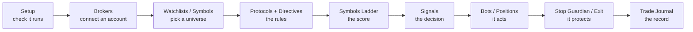

# Project Proposal — Python Automation

## Project Understanding
You need assistance with: 
**Beta minimum: which pages ship, and what must work before a new user sees it**

*Project description:*
## What this issue is for

A **beta minimum**: the smallest version of this app a stranger can install, open, and believe works.

The bar is not profit. It is:

> **Can the user see everything we intend to offer, working at least?**

Every page gets exactly one emoji verdict below. Verdicts are **proposals** — this issue is the place we overrule them, and the emoji changes. That is the whole tracking mechanism.

| Emoji | Meaning | Consequence |
|---|---|---|
| 🟢 | **In beta nav** — must work | Visible; a fault here blocks the beta |
| 🟡 | **In beta nav, secondary** | Visible; works; no polish budget |
| 🔴 | **Hidden at beta** | Withheld; announced as a Coming Feature |
| ⚪ | **Owner-only** | Stays on the dev machine; never in a beta user's nav |
| 💀 | **Delete** | Duplicate or dead; remove, do not hide |

**Mechanism already exists.** `src/core/hidden-views.js` → `DEFAULT_HIDDEN_ROUTES`, enforced by `scripts/validate-page-visibility.cjs` in `prebuild`. "Moving an id OUT of this list IS the release." So hiding is a one-line-per-page change, not a build.

---

## The proposal, in numbers

Measured 2026-11-26 by joining `NAV_TREE` + `DEFAULT_HIDDEN_ROUTES` + the Page Walkthrough (`appsetting.uiReview`, 144 verdicts, 103 with a UI/10 score).

| Verdict | Count |
|---|---|
| 🟢 In beta | **22** |
| 🟡 Secondary | **14** |
| 🔴 Hidden | **53** |
| ⚪ Owner-only | **22** |
| 💀 Delete | 0 in nav (3 duplicate **routes** exist outside it — see Blockers) |
| **Total nav routes** | **111** |

⇒ Visible nav goes from **111 → 36** (**68% reduction**). The `education` area is already hidden wholesale and is excluded.

---

## The beta spine — what a user must see working

Each arrow is a page in the 🟢 set. If any arrow is missing, the story breaks and the beta reads as a demo.

---

## page inventory — verdict per page

### Dashboard

| | Page | Route | UI/10 |
|---|---|---|---|
| 🟢 | Dashboard | `/dashboard/dashboard` | 8 |

### Accounts

| | Page | Route | UI/10 |
|---|---|---|---|
| 🟢 | Portfolio | `/trading212/t212-portfolio` | 6 |
| 🟢 | Brokers | `/trading212/brokers` | — |
| 🔴 | Vendors | `/trading212/vendors` | — |

### Watchlists

| | Page | Route | UI/10 |
|---|---|---|---|
| 🟢 | Active Symbols | `/watchlists/active-symbols` | 8 |
| 🟢 | Watchlists | `/watchlists/user-watchlists` | 6 |
| 🔴 | Registered Movers | `/watchlists/registered-movers` | — |

### Research

| | Page | Route | UI/10 |
|---|---|---|---|
| 🟢 | Symbols Browser | `/research/symbols-browser` | 8 |
| 🟢 | Screener | `/research/screener` | 4 |
| 🟢 | Earnings Calendar | `/research/earnings-calendar` | 4 |
| 🟢 | News Intel | `/research/news-intel` | 7 |
| 🔴 | Notes | `/research/research-notes` | 8 |
| 🔴 | Earnings Whispers | `/research/earnings-whispers` | 4 |
| 🔴 | Stock Investigation | `/research/stock-investigation` | 1 |
| 🔴 | Market Correlations | `/research/market-correlations` | 4 |
| 🔴 | Recently Analysed | `/research/recently-analysed-symbols` | 3 |
| 🔴 | Daily Briefing | `/research/daily-briefing` | 4 |
| 🔴 | Most Active | `/research/most-active` | — |

### Protocols

| | Page | Route | UI/10 |
|---|---|---|---|
| 🟢 | Protocols Registry | `/protocols/protocols-registry` | 8 |
| 🟢 | Directives Registry | `/protocols/directives-registry` | 8 |
| 🟡 | Protocols Ladder | `/protocols/protocols-ladder` | 7 |
| 🔴 | Protocol Comparison | `/protocols/sees-arena` | 4 |
| 🔴 | Protocol Builder | `/protocols/protocol-builder` | 7 |
| 🔴 | Protocol Trail | `/protocols/protocol-trail` | 6 |
| 🔴 | Directive Viewer | `/protocols/directive-viewer` | 4 |
| 🔴 | Dual-Protocol Inspector | `/protocols/dual-protocol-inspector` | 3 |
| 🔴 | Protocol Queue | `/protocols/protocol-queue` | 1 |

### Scoring

| | Page | Route | UI/10 |
|---|---|---|---|
| 🟢 | Symbols Ladder | `/scoring/symbols-ladder` | 8 |
| 🟡 | Ladder (live ordering stack) | `/scoring/live-ordering-stack` | 9 |
| 🔴 | A/B Ladder | `/scoring/ab-ladder` | 7 |
| 🔴 | Single Symbol | `/scoring/singles-monitor` | 4 |
| 🔴 | Scoring Activity Logs | `/scoring/scoring-activity-logs` | 5 |

### Signals

| | Page | Route | UI/10 |
|---|---|---|---|
| 🟢 | Signals | `/signals/signals-overview` | 8 |

### Bots

| | Page | Route | UI/10 |
|---|---|---|---|
| 🟢 | Trading Bots | `/bots/trading-bots` | — |
| 🔴 | Create Bot | `/bots/bot-create` | — |
| 🔴 | Bot Monitor | `/bots/strategy-monitor` | — |
| 🔴 | Bot Comparison | `/bots/strategy-comparison` | — |

### Trading

| | Page | Route | UI/10 |
|---|---|---|---|
| 🟢 | Positions Monitor | `/trading/positions-monitor` | 5 |
| 🟢 | Exit Signals | `/trading/exit-signals` | 6 |
| 🟢 | Stop Guardian | `/trading/stop-guardian` | 4 |
| 🟢 | Trade Journal | `/trading/trade-journal` | 3 |
| 🟡 | Manual Trading | `/trading/mt5-trading` | 5 |
| 🔴 | Speed Scanner | `/trading/speed-scanner` | 7 |
| 🔴 | Strategies | `/trading/strategies-derived` | 5 |
| 🔴 | A/B Strategies | `/trading/ab-strategies` | 6 |
| 🔴 | Trading Plans | `/trading/trading-plans` | 5 |
| 🔴 | Market Context | `/trading/market-context` | 2 |
| 🔴 | Trading Performance | `/trading/performance-lab` | 4 |
| 🔴 | Calculators | `/trading/calculators` | 5 |
| 🔴 | Settings (duplicate) | `/trading/trading-settings` | 6 |

### Strategies

| | Page | Route | UI/10 |
|---|---|---|---|
| 🟡 | Strategy Library | `/strategies/strategy-library` | — |
| 🔴 | Day's Top Winners | `/strategies/day-top-winners` | — |
| 🔴 | Day's Top Losers | `/strategies/day-top-losers` | — |

### Status

| | Page | Route | UI/10 |
|---|---|---|---|
| 🟢 | Setup & Diagnostics | `/status/setup` | 6 |
| 🟢 | Health & Diagnostics | `/status/health-check` | 6 |
| 🟢 | META.Stack Status | `/status/meta-stack-status` | 7 |
| 🟡 | META.Stack Explorer | `/status/meta-stack-explorer` | 9 |
| 🟡 | Order Testing | `/status/order-testing` | 5 |
| 🟡 | Broker Catalogue | `/status/broker-catalogue` | — |
| 🔴 | System Log | `/status/system-log` | 6 |
| 🔴 | API Comparisons | `/status/platform-comparisons` | 7 |
| 🔴 | Capability Map | `/status/capability-map` | 5 |
| 🔴 | Scheduled Jobs | `/status/scheduled-jobs` | 3 |

### Lab

| | Page | Route | UI/10 |
|---|---|---|---|
| 🟡 | Backtesting Protocols | `/lab/backtest` | 4 |
| 🔴 | Backtest Strategies | `/lab/backtest-strategies` | — |
| 🔴 | Movers Strategy | `/lab/movers-strategy-backtest` | — |
| 🔴 | Current Strategy | `/lab/current-strategy` | — |
| 🔴 | Backtest Data | `/lab/backtest-data` | — |
| 🔴 | Completed Runs | `/lab/backtest-runs` | — |
| 🔴 | Experiments | `/lab/backtest-experiments` | — |
| 🔴 | Walk-Forward Survivors | `/lab/walk-forward-survivors` | — |
| 🔴 | Snapshots | `/lab/snapshots` | 4 |
| 🔴 | Snapshot Replay | `/lab/snapshot-replay` | 4 |
| 🔴 | Charts Lab | `/lab/charts-lab` | 2 |
| 🔴 | Position Lifecycle | `/lab/position-lifecycle` | 3 |

### Planner

| | Page | Route | UI/10 |
|---|---|---|---|
| 🔴 | Personal Finances | `/planner/personal-finances` | 1 |
| 🔴 | Trading Styles | `/planner/trading-styles` | 2 |
| 🔴 | Objectives | `/planner/objectives` | 4 |

### Settings

| | Page | Route | UI/10 |
|---|---|---|---|
| 🟢 | Risk Controls | `/settings/risk-controls` | 7 |
| 🟡 | Trading | `/settings/trading-settings` | 6 |
| 🟡 | Scoring | `/settings/scoring-settings` | 6 |
| 🟡 | Automation | `/settings/automation` | 6 |
| 🟡 | General | `/settings/settings` | 5 |
| 🟡 | Appearance | `/settings/appearance` | 8 |
| 🟡 | User Preferences | `/settings/user-preferences` | 8 |
| 🔴 | Monitoring | `/settings/monitoring` | 8 |
| 🔴 | Screen Assignment | `/settings/screen-assignment` | 8 |
| 🔴 | Database | `/settings/settings-database` | 8 |
| 🔴 | Education | `/settings/settings-education` | 8 |

### Development — ⚪ all 22, owner-only

| | Page | Route |
|---|---|---|
| ⚪ | Roadmap | `/development/roadmap` |
| ⚪ | QA Checklist | `/development/qa-testing` |
| ⚪ | Commands Reference | `/development/commands` |
| ⚪ | File Inventory | `/development/file-inventory` |
| ⚪ | Database Tables | `/development/database-tables` |
| ⚪ | Theory Registry | `/development/theory-registry` |
| ⚪ | Design Observations | `/development/design-observations` |
| ⚪ | Queued Changes | `/development/queued-changes` |
| ⚪ | Feature Lab | `/development/feature-lab` |
| ⚪ | Page Walkthrough | `/development/ui-review` |
| ⚪ | Identity Map | `/development/identity-map` |
| ⚪ | Diagrams | `/development/diagrams` |
| ⚪ | Blocked Signals | `/development/blocked-signals` |
| ⚪ | Trend Reading | `/development/trend-reading` |
| ⚪ | Market Movers | `/development/movers-treatment` |
| ⚪ | Performance Change | `/development/performance-change` |
| ⚪ | Theme | `/development/theme` |
| ⚪ | Responsive Layout Lab | `/development/responsive-layout-lab` |
| ⚪ | META.Stack Cockpit | `/development/meta-stack-cockpit` |
| ⚪ | Pipeline Graph | `/development/pipeline-graph-lab` |
| ⚪ | Strategy Wizard | `/development/strategy-wizard` |
| ⚪ | Architecture | `/development/architecture-framework` |

---

## 1. Which pages are vital?

The 🟢 22 above, and the reason each is there:

| Step | Pages | Why it cannot be cut |
|---|---|---|
| Check it runs | Setup, Health | Without these a broken install looks like a broken app |
| Connect | Brokers, Portfolio | There is no account = no prices = nothing to show |
| Universe | Active Symbols, Watchlists | The user must see *which* symbols the app is watching |
| Rules | Protocols Registry, Directives Registry | These are the product. **144 directives across 60 protocols** (live `GET /api/directives`, 2026-11-26) is the differentiator |
| Score | Symbols Ladder, META.Stack Status | The scoring is the reason to install |
| Decide | Signals | A score the user cannot see as a decision is a number |
| Act | Bots, Positions Monitor | The proof it does something |
| Protect | Stop Guardian, Exit Signals | The proof it is not reckless |
| Record | Trade Journal | The proof it happened |
| Control | Risk Controls | The proof the user is in charge |
| Research | Symbols Browser, Screener, News, Earnings | Makes it useful before a single trade |

⚠️ **`/bots/bot-create` is hidden on purpose, and it is not cosmetic.** `POST /api/trading/strategies` does **not** create a `strategy_protocol` subscription, and `SignalQueueService` routes by subscription — so a bot created in the UI **silently never trades**. Showing a Create button that produces a dead bot is the single worst first impression available. Seeded bots only, until that write path is fixed.

---

## 2. Login and account setup — is it supportive enough?

**Short answer: there is no login screen, and account setup is the weakest link in the whole beta.**

| Question | Measured answer |
|---|---|
| Is there a login page? | **No.** Zero frontend references to `api/auth`, `useAuth`, or `auth/login` |
| Does the API have auth? | **Yes, half-built.** `POST /auth/login`, `/auth/register`, `/auth/api-keys`, `GET /auth/me` — nothing calls them |
| Is auth enforced? | Only on `automation` and `mt5-trading`, via `RequireAuthGuard`, gated on `REQUIRE_API_AUTH` |
| What happens if a user sets `REQUIRE_API_AUTH=true`? | 🛑 **Bot and manual-trading endpoints 401 for every user.** There is no way to obtain a token in the UI |
| Can a user add a broker account? | 🛑 **No.** Tracked in #1297 — accounts live in `.env` or are discovered from a bridge |

**The beta position that follows:** the app is a **single-user, local-only** application. That is a legitimate beta *if stated*: "runs on your own machine, one user, no cloud". It is not legitimate to imply multi-user or remote access.

**Affiliate opportunity — the home already exists.** `src/core/broker-catalogue.js` carries an `affiliateUrl` field on every broker entry, and all are currently `null` by design (`BrokersPage.jsx` falls back to `website`). So placing affiliate links is **filling a field per broker**, not building a system. The natural sequence a new user already follows — Brokers → pick a venue → open an account — is exactly where they belong.

| Option | Pros | Cons |
|---|---|---|
| 🟢 Affiliate links on the Brokers page (fields exist) | Free to place; matches the real user journey; no new UI | Needs the broker's programme; must be disclosed |
| Login screen before beta | Enables multi-user later | Meaningless for a local-only beta; large work for zero beta value |
| Leave both until after beta | Zero cost now | Leaves the strongest monetisation point unused |

---

## 3. Windows installer — is it worth it?

**The question is already answered in #808 and I am not duplicating it.** Decided shape: **Electron/Tauri app + a thin MQL5 helper EA** — because MQL5 Market lists compiled MQL5 binaries and cannot list a React+NestJS+Python app. The feasibility step (a minimal EA reading a score from the local API) is called out there as *the highest-value unknown*.

So: **a Windows installer is worth it, Windows is not a limitation, and it is not a beta blocker.** Reasoning, with the database clarity asked for:

### Database requirements — measured

| Component | Requirement | Evidence |
|---|---|---|
| **Database** | **MySQL 8.0+** | `nest/prisma/schema.prisma` → `provider = "mysql"`; `docker-compose.yml` → `mysql:8.0` |
| Redis | **Optional** | `QUEUE_MODE=off` is the default; `mode: fallback` in `/api/health` is normal |
| Node.js | 18+ (CI pins 20) | `SETUP.md`; `.github/workflows/*.yml` |
| Python | 3.x + `flask`, `MetaTrader5` | `scripts/mt5-bridge/requirements-mt5.txt` |
| MT5 terminal | Only for **trading** | Track A runs without it — measured 2026-10-31: `/api/health` `ok`, DB connected |
| Host OS | **Windows for the bridge only** | The MT5 terminal is Windows software; Track A runs anywhere |

⇒ **For an installer, MySQL is the awkward dependency**, not Python or Node. #808 already names the fix candidate (bundle MySQL, or migrate to SQLite for a single-user install).

### 🛑 The real beta blocker is not the installer — it is that a fresh install is EMPTY

`SETUP.md` states it plainly: *"There is no sample or demo data … A fresh install with nothing connected shows an empty application — deliberately."*

That is the correct engineering choice and the wrong **beta** choice. A stranger installs, sees empty tables, and has no way to tell "working, no data" from "broken". **No issue tracks this.** Proposed: a **read-only sample dataset** (a few symbols, seeded bars, seeded bots, one completed backtest) that the setup wizard offers to load, clearly labelled as sample.

Ranking, on evidence:

| # | What | Why it ranks here |
|---|---|---|
| **1** | 🟢 **Sample dataset** | Without it, every page that matters looks broken on first run |
| **2** | 🟢 Fix `.env.example` (says **postgresql**, app is **mysql**) | A new user following the template cannot connect at all |
| **3** | 🟢 Fix the Docker path (two defects, see Blockers) | The documented container route cannot start |
| **4** | 🟡 Windows installer (#808) | Valuable, but only after 1–3 or it packages an empty app |

---

## 4. Hidden pages as Coming Features

Grouped into packs — the existing `hidden-views.js` already uses "Pack N" language, so these extend it rather than inventing a scheme.

| Pack | Pages | One-line pitch |
|---|---|---|
| **A — Backtesting suite** | 11 Lab pages | Test a strategy against years of bars before risking a penny |
| **B — Research depth** | 7 | Notes, whispers, correlations, daily briefing, stock reports |
| **C — Protocol authoring** | 6 | Build, compare, trail and inspect your own protocols and directives |
| **D — Trading tactics** | 6 | Speed scanner, A/B strategies, trading plans, market context, performance lab |
| **E — Personal planning** | 3 | Objectives, trading styles, personal finances |
| **F — Account & system depth** | 6 | Vendors, registered movers, system log, API comparisons, capability map, scheduled jobs |
| **G — Strategy screens** | 2 | Day's top winners and losers |

### Status

| Surface | State |
|---|---|
| **Website** — "Held back on purpose" section on `site/index.html` | ✅ **Added** — seven pack cards + a `#coming` nav link, linking back to this issue. `validate-public-claims` and `validate-text-encoding` both pass; release stage remains `alpha` |
| **Reddit post** (r/TradingCommandSuite) | 🟨 **Drafted**, not published — see [the drafts comment](#issuecomment-7193445120) |
| **Discord announcement** | 🟨 **Drafted**, not published — same comment |

⚠️ **Both drafts are written from the proposals above, so they must not be published until tracker steps 1–2 are settled.** Advertising a pack list that then changes is worse than advertising late. Nobody has posted to Reddit or Discord — that is an owner action, and a badly received first post is not reversible.

---

## 5. UI/UX parameters — what makes a page good or bad here

This is the part most worth keeping, because it is the only thing that transfers to another agent. **Parameter 1 is the one that matters: the verdicts already on record agree with each other far more than the scores do.**

### The numbers say scores are not the signal

| UI/10 | Count | What it actually correlates with |
|---|---|---|
| 8–9 | 26 | Mostly "unique layout worth copying to a theme library" |
| 6–7 | 35 | "Works, needs a specific fix" |
| 1–5 | 42 | Mixed: some are broken, some are just old |
| unrated | 41 | **Not low — unjudged** |

⚠️ A 4/10 page (`screener`) carries a **PREFERRED ELEMENTS** note calling its table unique and wanted in the final theme. A 1/10 page (`stock-investigation`) is 1/10 only because the AI phase has not started. **So score ≠ bad page.** Never use the score alone to decide a hide.

### The six parameters that DO predict a bad page

Derived from the 25 PREFERRED-ELEMENTS verdicts versus the failure notes — each one is testable by looking at a screenshot.

| # | Parameter | A GOOD page | A BAD page | Evidence |
|---|---|---|---|---|
| **1** | **It loads something** | Every panel has data or says "no data yet" | Silently blank | `directive-viewer`, `protocol-trail`: *"does not load anything"* |
| **2** | **One table style across the app** | Shares the canonical table | Its own table styling | `earnings-calendar`: *"not styled in-line with the rest of the app … agentic AI has saw fit to come up with something different"* |
| **3** | **Density is chosen, not defaulted** | Lots on one screen **or** an accordion — deliberately | Everything expanded at once | `trade-journal`, `strategies-derived`: *"turn them into accordions"* |
| **4** | **The changing number is the visible one** | The part that moves is highlighted | Uniform weight, so nothing stands out | `symbols-ladder` (8/10): *"slashed stats with a partly coloured value … makes the part that changes really stand out"* |
| **5** | **A unit or a label on every derived number** | `60/100 (score)` | `60` with no scale | `meta-stack-explorer`: *"showing a scoring out of 100 … it should say so"* |
| **6** | **No controls that cannot act** | Every button changes something | A toggle the backend ignores | The `hidden-views.js` docblock: eight hide-toggles pointed at routes that were not in the nav, so only one could ever act |

### The two that are this repo's own failure signature

> **"Plausible output, no error, wrong shape underneath."**

- **Parameter 1 is that signature in the UI**: a blank panel is not an error, it is a page that looks fine and tells the user nothing.
- **Parameter 6 is that signature in a control**: a toggle that is *reachable* but cannot *act* is worse than absent, because it looks like a capability.

### The parameter I would give DeepSeek first

**Ask not "is this attractive?" but "what does this page let the user DO, and can they see it happened?"**

Every 8–9/10 page on record answers both. Every 1–2/10 page answers neither. That single question predicted the owner's verdicts better than any visual judgement, and it needs no taste to apply.

---

## Blockers found while measuring this

Not part of the beta decision, but found on the way and fixed or filed:

| # | Finding | Status |
|---|---|---|
| 1 | `scripts/audit-ui-review.cjs` required `./scripts/lib/mysql-cli.cjs` — resolved to `scripts/scripts/…`, so the tool could not run at all | ✅ **Fixed** (`./lib/mysql-cli.cjs`) |
| 2 | Same tool: `const REPO = __dirname` → `scripts/`, so it reported `nest/app-settings.json` as **UNREADABLE** and *"counts differ — DB wins"*. That is a **false drift alarm from its own path bug**, not real drift. After the fix: canonical **144**, mirror **144**, `agree YES` | ✅ **Fixed** (`path.resolve(__dirname, '..')`) |
| 3 | `docker-compose.yml` runs `npx prisma db push` — the destructive command this repo bans (drops unmodelled tables) — as its API start command | 🛑 **Open** — the container path can destroy data |
| 4 | `docker-compose.yml` runs `node dist/main.js`, which **does not exist**; the build emits `nest/dist/src/main.js`. The container cannot start the API | 🛑 **Open** |
| 5 | `nest/.env.example` ships `postgresql://…` while the schema is `mysql` | 🛑 **Open** |
| 6 | Duplicate **routes** (outside the nav): `/dashboard`, `/dashboard/screen`, `/builder/architecture-framework` | 🛑 **Open** — delete the duplicates |

---

## Progress tracker

Emoji only, updated in place. ⬜ = not started · 🟨 = agreed, not done · ✅ = done · 🛑 = blocked

| # | Step | Status |
|---|---|---|
| 1 | Agree the 🟢 beta spine (22 pages) | ✅ **agreed 2026-11-26** |
| 2 | Agree the 🔴 hidden set + pack names | 🟨 proposed — 53 pages, 7 packs |
| 3 | Apply verdicts to `hidden-views.js` (one line per page) | ⬜ |
| 4 | `validate-page-visibility` green, nav verified in the running app | ⬜ |
| 5 | Sample dataset for first run | ⬜ |
| 6 | Fix `.env.example` database URL | ⬜ |
| 7 | Fix the Docker path (db push + entry point) | ⬜ |
| 8 | Delete the 3 duplicate routes | ⬜ |
| 9 | Affiliate links on Brokers | ⬜ |
| 10 | Statement of beta scope (single-user, local-only) | ⬜ |
| 11 | Coming Features section on the website | ✅ |
| 12 | Reddit + Discord post (written from final verdicts) | 🟨 |
| 13 | Windows installer — follow #808, after 5–7 | ⬜ |
| 14 | **Decide Signals** — which single strength number survives | ⬜ |
| 15 | **Hide the 6 named in-page features** (see readiness comment) | ⬜ |
| 16 | **Confirm Brokers stays visible** as "what the app found" | ⬜ |
| 17 | **Re-key the 5 moved walkthrough routes** before trusting any absence | ⬜ |

> **Page readiness (2026-11-26):** 22 agreed · **10 🟢 ready · 10 🟡 need one named fix · 2 🔴 not ready.** Full breakdown: [readiness audit](#issuecomment-7195151511).

---

## Deliberately not in this issue

- **Packaging design and feasibility** — owned by #808. This issue only ranks it.
- **Broker account registration from the UI** — owned by #1297.
- **Whether a page is worth keeping long-term** — this issue decides *beta visibility*, not product direction. A 🔴 is withheld, never judged.

## Scope of Work
- Asset analysis and workspace initialization.
- Core modeling / development based on specifications.
- Technical validation and quality checks.
- Incorporation of review feedback.
- Clean handover of source files and documentation.

## Required Files & Inputs
1. Complete reference files (drawings, access tokens, test data).
2. Exact dimensional specs or business rules.
3. Schedule/deadline expectations.

## Estimated Price and Timeline
- **Estimated Price:** 200 - 600 USD
- **Estimated Timeline:** 3 to 7 business days (to be refined after reviewing the final assets).

## Project Questions
To help me refine this estimate, please clarify:
1. What is the input data format (Excel sheets, CSV, website, database)?
2. What are the step-by-step logic rules for processing the data?
3. Where should the output be saved (merged sheet, email, database)?
4. Does this script need to run on a schedule (cron, Windows Scheduler) or manually?
5. Can you share sample data files for testing?

## Agreement Terms
The final source files will be delivered upon approval of the milestones. Substantial revisions outside the agreed scope will require a change order.
